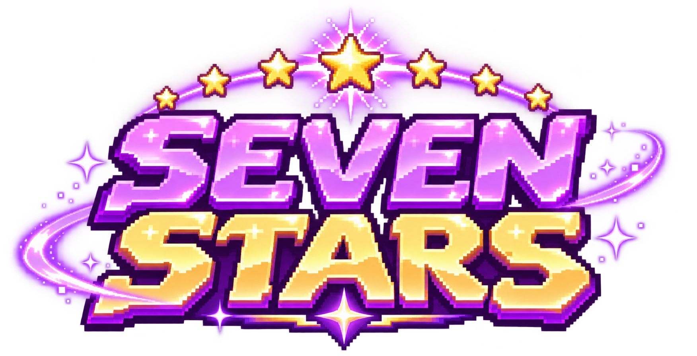

# Seven Stars

  

  

Una aventura entre estrellas: elige a tu personaje, salta entre plataformas, recoge estrellas y avanza por las etapas. ¡Cuida tus corazones y supera tu récord!

## Jugar

Abre `index.html` en un navegador moderno. No necesitas instalar dependencias ni compilar el proyecto.

Elige entre Namu, Jino, Yuno, Hobi, Jiminie, Taeo y Kookie para comenzar la carrera.

## Controles

- **Computador:** pulsa Espacio o la flecha hacia arriba para saltar; pulsa Esc para pausar o continuar.
- **Pantalla táctil:** toca el juego para saltar y usa el botón de pausa para detener la partida.
- Pulsa o toca dos veces para hacer un doble salto.

## Archivos

- `index.html`: estructura del juego.
- `style.css`: estilos de la interfaz.
- `game.js`: lógica y animaciones.
- `images/branding/`: logo e imagen de los personajes.
- `images/portraits/`: retratos de selección.
- `images/sprites/`: sprites de personajes y elementos del juego.
